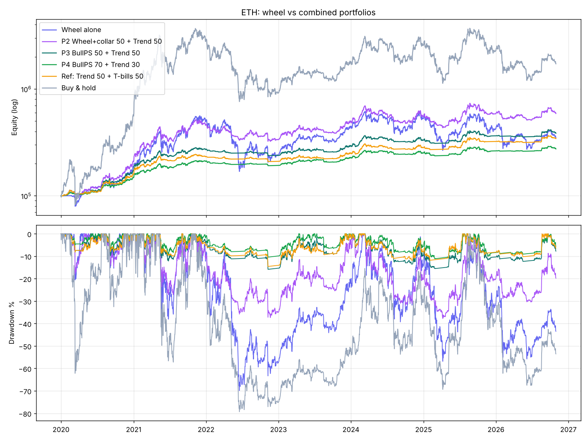
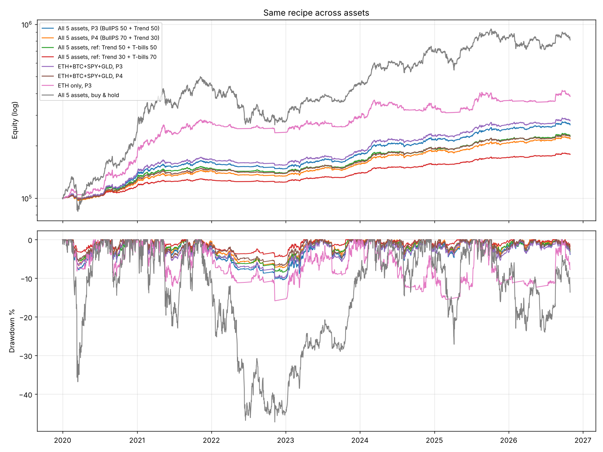

# Combining the strategy with complementary sleeves: consistent returns, small drawdowns

```bash
python combo_study.py      # about 1 min, writes results/combo/
```

## The idea

The regime analysis ([REGIMES.md](REGIMES.md)) showed the wheel wins in bear and sideways markets and loses badly in rallies.
So the fix is to pair it with sleeves that earn in the regimes where it fails:

| Regime | Sleeve that earns |
|---|---|
| Strong rally | **Trend sleeve**: hold ETH while it is above its moving averages, sized to a 40 % volatility target |
| Grind up / sideways | **Bull put-spread ladder**: weekly 35-day 25Δ/10Δ put spreads, only above the 200DMA, 2 % max loss each |
| Bear market | Both sleeves step aside into T-bills (the trend sleeve exits, the put ladder stops selling) |
| Crash | Defined-risk spreads cap the loss, and the trend sleeve has usually already exited |

### Sleeve rules (fixed in advance)

* **Trend sleeve.** Each day, count how many of the 50/100/200-day moving averages ETH closes above (0, 1/3, 2/3 or 1).
  Target weight = that fraction × min(1, 40 % / implied vol). The trade happens at the **next** day's close.
  It only rebalances when the target moves by more than 10 points. Cash earns T-bills. Using an ensemble of three
  MAs avoids picking a single "lucky" length. On their own, the 50DMA did much better than the 100DMA, which is exactly why no single one is used.
* **Bull put-spread ladder.** This is strategy G from [IMPROVEMENTS.md](IMPROVEMENTS.md), unchanged.
* **Portfolio.** Fixed weights, rebalanced monthly.

## Results on ETH (2020-01-01 → 2026-10-30)

| Portfolio | CAGR | Max DD | Worst year | 2020–23 CAGR / DD | 2024–26 CAGR / DD |
|---|---|---|---|---|---|
| Original wheel alone | 20.0 % | **-69.9 %** | -52.2 % | 44.6 / -69.9 | **-8.5 / -56.8** |
| Wheel 50 + Trend 50 | 30.5 % | -46.9 % | -33.5 % | 51.4 / -46.9 | 5.0 / -41.7 |
| Wheel + collar 50 + Trend 50 | 29.6 % | -37.8 % | -27.0 % | 48.8 / -37.4 | 5.9 / -37.8 |
| **P3: Put-spreads 50 + Trend 50** | **21.8 %** | **-15.8 %** | -11.9 % | 30.7 / -15.8 | 9.8 / -15.5 |
| **P4: Put-spreads 70 + Trend 30** | **15.9 %** | **-11.1 %** | -8.5 % | 22.7 / -10.4 | 6.7 / -11.1 |
| *Ref: Trend 50 + T-bills 50* | *19.8 %* | *-14.6 %* | *-9.5 %* | *25.7 / -14.6* | *11.5 / -11.8* |
| *Buy & hold ETH* | *51.6 %* | *-79.3 %* | *-67.5 %* | *104.4 / -79.3* | *-1.6 / -67.6* |

Calendar years (ETH):

| Year | P3 | P4 | Wheel alone | Buy & hold |
|---|---|---|---|---|
| 2020 | 71.6 % | 48.4 % | 87.9 % | 463.1 % |
| 2021 | 58.2 % | 41.8 % | 166.0 % | 399.2 % |
| 2022 | **-11.9 %** | **-8.5 %** | -52.2 % | -67.5 % |
| 2023 | 22.1 % | 17.8 % | 83.0 % | 90.8 % |
| 2024 | 13.2 % | 10.8 % | 20.8 % | 46.3 % |
| 2025 | 10.1 % | 4.8 % | -19.7 % | -11.0 % |
| 2026 YTD | 5.6 % | 4.3 % | -17.7 % | -24.4 % |

**Fresh start every 1 January (CAGR to Oct 2026 / max DD):**

| Start | P3 | P4 | Wheel alone | Buy & hold |
|---|---|---|---|---|
| 2020 | 21.8 / -15.8 | 15.9 / -11.1 | 20.0 / -69.9 | 51.6 / -79.3 |
| 2021 | 15.2 / -15.8 | 11.4 / -11.1 | 5.1 / -69.1 | 21.3 / -79.3 |
| 2022 | 7.8 / -15.5 | 6.1 / -11.1 | 2.3 / -57.3 | -10.1 / -74.0 |
| 2023 | 13.2 / -15.5 | 9.7 / -11.1 | 0.2 / -53.9 | 17.8 / -67.6 |
| 2024 | 9.7 / -15.4 | 6.5 / -10.9 | -2.4 / -53.9 | -1.6 / -67.6 |
| 2025 | 8.5 / -12.3 | 4.9 / -10.1 | -2.2 / -52.7 | -19.8 / -67.6 |



## Best result: the same recipe across several assets

Running the same two sleeves on each asset and splitting capital equally is the biggest drawdown reducer.
The assets' trends and sell-offs don't line up.

| Portfolio (equal weight per asset) | CAGR | Max DD | Worst year | Positive months | 2020–23 | 2024–26 |
|---|---|---|---|---|---|---|
| **ETH+BTC+SPY+GLD, P4 (puts 70 / trend 30)** | **12.7 %** | **-6.8 %** | **-5.4 %** | **69 %** | 12.7 % / -6.8 % | 12.5 % / -4.5 % |
| ETH+BTC+SPY+GLD, P3 (puts 50 / trend 50) | 16.2 % | -10.0 % | -7.4 % | 64 % | 16.8 % / -10.0 % | 14.9 % / -5.4 % |
| All 5 (adds QQQ), P4 | 12.2 % | -7.3 % | -6.4 % | 65 % | 12.0 % / -7.3 % | 12.3 % / -4.7 % |
| All 5, P3 | 15.3 % | -10.4 % | -8.4 % | 64 % | 15.6 % / -10.4 % | 14.5 % / -5.4 % |
| *All 5, ref: Trend 50 + T-bills 50* | *12.8 %* | *-8.4 %* | *-5.9 %* | *63 %* | | |
| *All 5, ref: Trend 30 + T-bills 70* | *8.8 %* | *-4.6 %* | *-2.8 %* | *65 %* | | |
| *All 5, buy & hold* | *35.8 %* | *-47.2 %* | *-37.9 %* | *61 %* | | |

ETH+BTC+SPY+GLD, P4, by year: 2020 **+26.6 %**, 2021 **+16.0 %**, 2022 **-5.4 %**, 2023 **+16.2 %**, 2024 **+18.9 %**, 2025 **+12.3 %**, 2026 YTD **+5.0 %**.

The cost stress test on the 5-asset P3 gave 15.3 % at base costs, 14.5 % with 2× option bid/ask, and 13.9 % with 2× bid/ask plus 3× spot fees.
Max DD stays at -10 to -11 %. Unlike the pure put-spread basket from before, this mix is not fragile to execution costs.



## What worked, what didn't, and an honest scorecard

**Worked**
1. **The trend sleeve is the missing piece.** It earns in the big rallies, where the wheel lost the most, and steps aside in crashes.
   The two sleeves' monthly returns are only modestly correlated (0.42).
2. **Defined-risk put spreads instead of the original wheel.** Every portfolio that kept the original wheel still had a -38 % to -47 % drawdown.
   That holds even with a protective-put collar, which did help the wheel itself (-70 % → -51 %).
3. **Diversifying across assets** roughly halved the drawdown (ETH-only P4 at -11 % → 4-asset P4 at -6.8 %).
4. **Consistency.** The 4-asset P4 earned about 12.5 % in *both* halves (2020–23 and 2024–26), and every year except 2022 was positive.

**Did not work**
* **Bear call spreads below the 200DMA** (to "earn in bear markets") lost money on ETH. That sleeve alone made 2.1 %/yr with a -21 % DD, because ETH's bear-market rallies are too violent.
  An **always-on iron-condor ladder** was negative (-3.1 %/yr). Both made the portfolio worse than plain put spreads.
* **Keeping the original wheel in the mix.** Its drawdown dominates any combination.

**Honest scorecard: what do the options add?**
On the 5-asset basket, a plain *trend + T-bills* mix gets about the same return per unit of drawdown.
Trend 50 + T-bills 50 made 12.8 % with a -8.4 % max DD. Trend 30 + T-bills 70 made 8.8 % with -4.6 %.
The put-spread sleeve **adds about +2.5 to +3.5 %/yr of return**, with somewhat higher drawdown, on top of what that T-bill money would earn.
It also earns in sideways markets, where trend sleeves often bleed.
So the options are a return enhancer here, not the drawdown fix. **The drawdown fix is the trend filter plus diversification.**

## Recommended setup

**Conservative ("reliable"):** ETH, BTC, SPY, GLD with 25 % of capital each. Within each asset:
* **70 % put-spread ladder:** every Monday, sell a 35-DTE 25Δ/10Δ put spread, only if the price is above the 200DMA.
  Size it so the max loss (width × qty) = 2 % of that sleeve. Hold to expiry. Collateral sits in T-bills / T-bill ETF / USDC yield.
* **30 % trend sleeve:** target weight = (share of 50/100/200 DMAs the price is above) × min(1, 40 % ÷ implied vol). Trade at the close the day after a change of more than 10 points.
* Rebalance the sleeves and assets monthly.

Backtest: **12.7 %/yr, -6.8 % max drawdown, worst year -5.4 %, 69 % of months positive.**

**Balanced:** the same, with 50 % put spreads / 50 % trend → **16.2 %/yr, -10 % max DD, worst year -7.4 %**.

**ETH only (if you must):** P4 → **15.9 %/yr, -11.1 % max DD**, but 2024–26 was only +6.7 %/yr.

## Caveats

* **This is a backtest over 2020–2026.** The 2020–21 crypto bull run flatters the trend sleeve.
  The 2024–26 half is a fairer guide: about 12.5 %/yr for the 4-asset P4.
* **Trend following has losing stretches.** 2022 was -5 % to -12 % across versions, and choppy markets cause whipsaw trades.
* **Option prices are modelled from vol indices** (DVOL, VIX, GVZ), not historical quotes. Pre-2021 crypto IV is a proxy.
* **The weights (70/30, 50/50) were fixed choices, not optimised.** The 40 % vol target and MA set were picked once and not tuned. The results file shows the alternatives.
* **Practical needs:** an options-enabled broker for SPY/GLD, Deribit (or similar) for ETH/BTC options, and enough capital for contract sizes.
  That means roughly $150k+ per ETF sleeve at 2 % risk per SPY spread, or XSP/narrower strikes for smaller accounts.
  Crypto adds exchange/counterparty risk.

## Files

* `combo_study.py`: the study. `strategy_lab.py` gained call credit spreads, protective puts (collar), `trend_hold()` and `combine()`
* `results/combo/eth_sleeves.csv`, `eth_portfolios.csv`, `eth_fresh_starts.csv`, `eth_yearly.csv`, `eth_sleeve_correlation.csv`
* `results/combo/per_asset.csv`, `multi_asset.csv`, `multi_asset_yearly.csv`, `cost_stress.csv`
* `results/combo/eth_portfolios.png`, `multi_asset.png`
