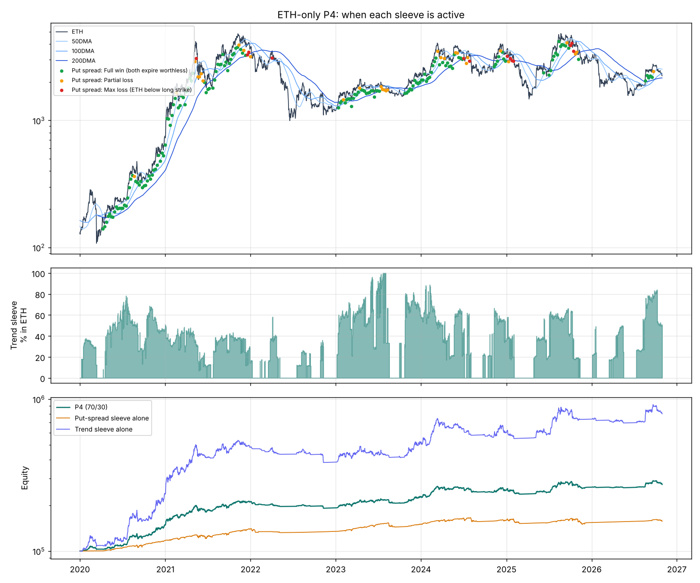

# How the ETH-only "P4" strategy works (70 % put spreads / 30 % trend)

Backtest 2020-01-01 → 2026-10-30: **15.9 %/yr, -11.1 % max drawdown, worst year -8.5 % (2022)**.
Reproduce with `python explain_eth_p4.py`. Every spread is listed in `results/explain/eth_put_spreads.csv`.

## The rules

Capital is split **70 % / 30 %** between two sleeves and rebalanced back to 70/30 once a month.
Idle cash in both sleeves earns the T-bill rate.

### Sleeve 1: put-spread ladder (70 %)
Once a week, after the daily close, **if ETH is above its 200-day moving average**:
1. **Sell** a 35-day put at about **25 delta**. On average that is 12 % below the price.
2. **Buy** a 35-day put at about **10 delta**. On average that is 25 % below the price.
3. Size it so that **max loss = strike width × quantity = 2 % of the sleeve**.
4. Hold to expiry. It is cash-settled, so you never end up owning ETH.

If ETH is below the 200DMA, sell nothing and wait. Because they're weekly with 35 days to run, about 5 spreads can be open at once.
On average only about 6 % of the sleeve is tied up as collateral, which is roughly 3 spreads.

### Sleeve 2: trend (30 %)
Each day:
1. Count how many of the **50/100/200-day MAs** ETH closes above. That gives a score of 0, ⅓, ⅔ or 1.
2. Target ETH weight = score × min(1, **40 % ÷ ETH implied vol**). With all three bullish and IV at 80 %, that is 50 % of the sleeve in ETH.
3. Trade at the **next** day's close, and only if the target changed by more than 10 points.

The sleeve was fully out of ETH 27 % of the time. Its average ETH weight was 32 %.

## Worked examples (real trades from the backtest)

**A winner: sold 2 Jan 2024.** ETH was $2,355 and implied vol was 69 %. The sleeve was worth $150.7k.
* Sell the 2,092 put, buy the 1,825 put, quantity 11.3 ETH.
* Width $267 × 11.3 = **max loss $3,014 (2.0 %)**. Credit received **$606** (20 % of the width).
* At expiry on 6 Feb, ETH was $2,373. Both puts expired worthless, so the trade **kept $606 (+0.4 %)**.

**The worst loser: sold 2 Jul 2024.** ETH was $3,421.
* Sell the 3,094 put, buy the 2,761 put, quantity 9.9, credit $612, max loss $3,300.
* On 5 Aug ETH crashed. At expiry on 6 Aug it was $2,461, below both strikes.
  **Loss: $2,689 (-1.6 % of the sleeve)**. It was capped by the long put. The short put alone would have paid out about $6,300.

## Why it makes money, and why the drawdown is small

**1. The put spreads win often and lose small** (201 spreads):

| Outcome | Share | Average P&L (% of sleeve) |
|---|---|---|
| Both puts expire worthless | 79 % | +0.42 % |
| Partial loss (ETH between strikes) | 15 % | -0.56 % |
| Max loss (ETH below long strike) | 6.5 % | -1.58 % |

Expected value is about **+0.14 % per spread**, with about 30 spreads a year.
The edge comes from ETH implied vol usually exceeding the moves that follow. The 200DMA filter also skips the bear markets where put sellers get hurt.
In 2022 the ladder sold only **one** spread.

**2. Most of the money is in T-bills most of the time.**
* On average about **10 % of total capital is in ETH**: the 30 % sleeve × a 32 % average weight. The most it can be is 30 %.
* Only about **4 % of capital is at risk** in open spreads.
* For the put sleeve, net option profit was **+$31k** and T-bill interest on its collateral was **+$30k**. About half that sleeve's return is just interest.

**3. The two sleeves cover each other.**
In big rallies (2020–21) the trend sleeve made +138 % / +103 %, while the put spreads were capped at +17–19 %.
In 2025 the put spreads lost -3.3 %, hit by sharp drops from above the 200DMA, while the trend sleeve made +23 %.
Their monthly correlation is only 0.42.

## Where the return came from, by year

| Year | Put-spread sleeve | Trend sleeve | 70 % × puts | 30 % × trend | **P4** | ETH |
|---|---|---|---|---|---|---|
| 2020 | 17.2 % | 137.9 % | 12.1 | 41.4 | **48.4 %** | 463 % |
| 2021 | 19.0 % | 102.8 % | 13.3 | 30.8 | **41.8 %** | 399 % |
| 2022 | -3.4 % | -20.2 % | -2.4 | -6.1 | **-8.5 %** | -68 % |
| 2023 | 11.3 % | 33.1 % | 7.9 | 9.9 | **17.8 %** | 91 % |
| 2024 | 6.2 % | 17.2 % | 4.3 | 5.2 | **10.8 %** | 46 % |
| 2025 | -3.3 % | 23.0 % | -2.3 | 6.9 | **4.8 %** | -11 % |
| 2026 YTD | 2.0 % | 8.4 % | 1.4 | 2.5 | **4.3 %** | -24 % |

*(The contribution columns don't sum exactly to P4 because of monthly rebalancing.)*

## Be realistic about the headline 15.9 %

* **2020–21 did most of the work.** Those two years were +48 % and +42 %, driven by the trend sleeve in a 5–10× ETH bull market.
  Since 2024 the strategy made about **6.7 %/yr**, when T-bills paid about 4.4 %.
* **Bad years:**
  * 2022 lost 8.5 %. The trend sleeve was whipsawed by bear-market rallies.
  * 2025 was weak. Sharp ETH drops (Mar–Apr and Nov 2025) hit put spreads sold while ETH was still above its 200DMA. Only 56 % of 2025's spreads won.
* **What we haven't seen yet:** a gap through both strikes on all ~5 open spreads at once. That would cost about 5 × 2 % × 70 % ≈ **7 % of total capital** in one go.
* **The model:** option prices come from Deribit's DVOL index with an assumed skew and spread, not from historical quotes. Pre-2021 vol is a proxy.

## Running it in practice (Deribit ETH options)

* **Every week:** check ETH vs. its 200DMA. If above, sell the ~35-day 25Δ put and buy the ~10Δ put with the same expiry.
  Size it to 2 % max loss. Deribit's minimum is 1 ETH contract, so 2 % risk on a $300–400 wide spread needs roughly **$15–20k** in the sleeve per contract.
* **Every day (or weekly, for simplicity):** update the trend weight and trade if it moved more than 10 points.
* **Monthly:** rebalance to 70/30. Keep idle cash in T-bills / tokenised T-bills / a USDC yield product, which adds counterparty risk.
