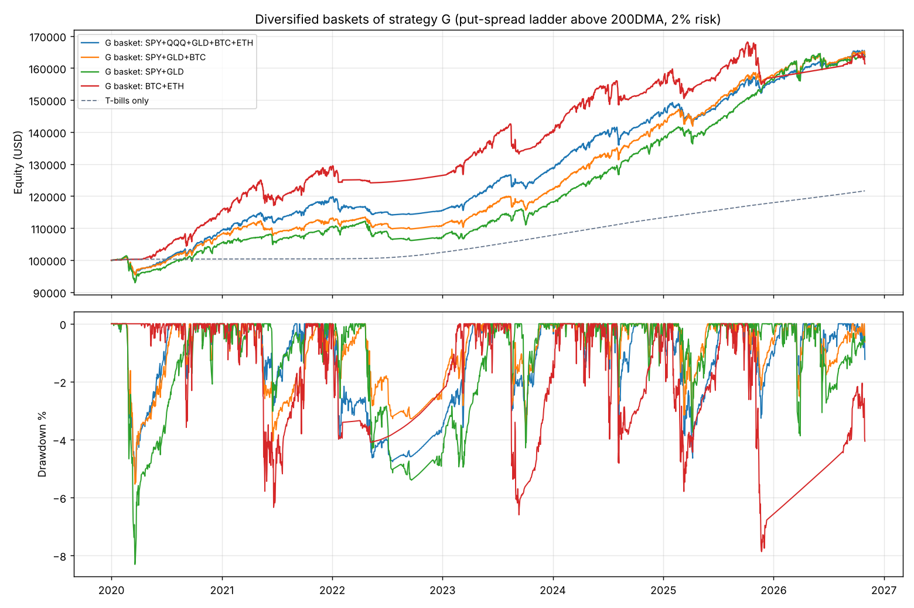
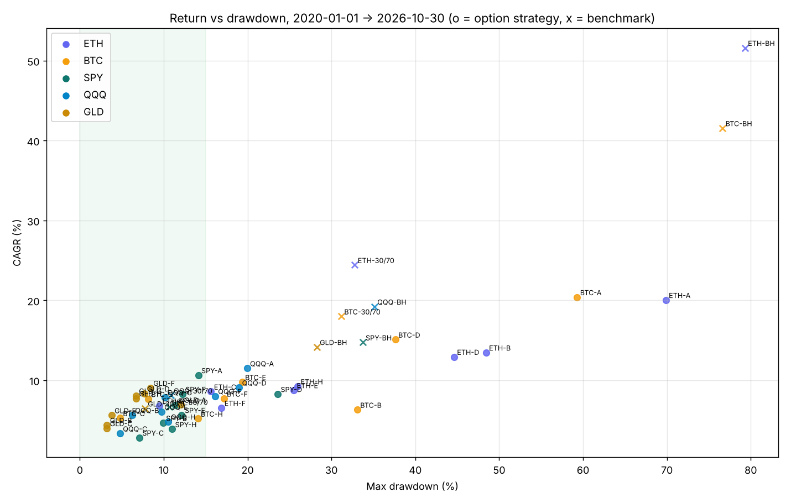

# Making the strategy lower-drawdown, and finding better instruments

Goal: **modest returns with the smallest possible drawdowns.**
Period: 2020-01-01 → 2026-10-30, $100k start. Cash and collateral earn the 3-month T-bill rate.
The T-bill rate was about 0 % in 2020–21 and 4–5 % from 2023, so T-bills alone compounded at **2.9 %/yr** over the period.

```bash
python improve_study.py      # about 2 min, writes results/improve/
```
The engine is `strategy_lab.py`. It reproduces the original ETH result ($327.5k vs $327.6k) when the
new features are switched off.

## TL;DR recommendation

**Strategy G, run on a diversified basket of underlyings:**

* Every week, sell a **35-DTE put credit spread**: short the **25Δ** put and buy the **10Δ** put.
* **Only when the underlying is above its 200-day moving average.**
* Size each spread so that its *maximum loss* (strike width × qty) = **2 % of equity**. About 5 are open at a time.
* Hold to expiry, cash-settled. Never take delivery and never hold the underlying.
* Keep all cash and collateral in T-bills.

| Basket (equal capital, no rebalancing) | CAGR | Max DD | Worst calendar year | Positive months |
|---|---|---|---|---|
| **SPY + GLD + BTC** | **7.5 %** | **-5.5 %** | **-1.9 %** | 75 % |
| SPY + QQQ + GLD + BTC + ETH | 7.5 % | -5.3 % | -3.3 % | 77 % |
| SPY + GLD | 7.5 % | -8.3 % | -3.0 % | 77 % |
| BTC + ETH | 7.2 % | -7.9 % | -1.8 % | 85 % |
| *Original ETH wheel (for reference)* | *20.0 %* | *-69.9 %* | *-52.2 %* | |
| *T-bills only* | *2.9 %* | *0 %* | | |



## The 8 variants tested (fixed in advance, not optimised)

| | Variant | What changes vs. the original |
|---|---|---|
| A | Original wheel | dip trigger, 60d 25Δ put, hold assigned asset, 14d 20Δ cash-settled calls |
| B | Classic wheel | A, but ITM calls sell the asset at the strike |
| C | B + trend | sell puts only above the 200DMA; sell the held asset when it closes below the 200DMA |
| D | Put-write ladder, 100 % | weekly 35d 25Δ puts, up to 100 % notional, cash-settled (never own the asset) |
| E | Put-write ladder, 50 % | D capped at 50 % notional |
| F | Put-spread ladder | weekly 35d 25Δ/10Δ spreads, 2 % max loss each |
| G | F + trend | F, only when above the 200DMA |
| H | Dip put spreads | your 5 % dip trigger, but 60d 25Δ/10Δ spreads at 3 % risk |

For equities and BTC, the dip trigger is scaled by volatility: a drop of at least 1.4 × the implied daily sigma. That works out to about -1.6 % for SPY and about -5 % for ETH.

### CAGR / max drawdown by instrument

| Variant | ETH | BTC | SPY | QQQ | GLD |
|---|---|---|---|---|---|
| A. Original wheel | 20.0 / -69.9 | 20.4 / -59.3 | 10.6 / -14.1 | 11.5 / -19.9 | 6.9 / -12.1 |
| B. Classic wheel | 13.5 / -48.4 | 6.3 / -33.1 | 4.7 / -9.9 | 5.7 / -6.2 | 4.4 / -3.2 |
| C. Classic wheel + trend | 8.6 / -15.6 | 5.3 / **-4.8** | 2.8 / -7.1 | 3.3 / -4.8 | 4.0 / -3.2 |
| D. Put-write 100 % | 12.9 / -44.6 | 15.1 / -37.6 | 8.3 / -23.6 | 9.1 / -19.0 | 8.4 / -7.7 |
| E. Put-write 50 % | 8.8 / -25.5 | 9.8 / -19.3 | 5.7 / -12.1 | 6.1 / -9.7 | 5.6 / -3.8 |
| F. Put-spread ladder | 6.5 / -16.9 | 7.7 / -17.2 | 8.3 / -12.2 | 8.0 / -16.1 | 9.0 / -8.4 |
| **G. Put-spread ladder + trend** | 6.8 / **-9.5** | 7.7 / **-8.1** | 6.9 / -11.4 | 7.9 / -10.1 | 8.1 / -6.7 |
| H. Dip put spreads | 9.2 / -26.0 | 5.2 / -14.1 | 3.9 / -11.0 | 4.8 / -10.5 | 7.7 / -6.7 |
| *Buy & hold* | *51.6 / -79.3* | *41.6 / -76.6* | *14.7 / -33.7* | *19.2 / -35.1* | *14.2 / -28.3* |
| *30 % asset / 70 % T-bills* | *24.4 / -32.8* | *18.0 / -31.2* | *6.7 / -10.6* | *8.1 / -10.8* | *6.5 / -7.7* |



## What actually reduces drawdown (in order of impact)

1. **Don't keep the assigned ETH as an open-ended long.** Holding it is what produced the -70 % drawdown.
   Switching to called-away (B) took it to -48 %. Never taking delivery (D/E/F) is cleaner still.
2. **Trend filter / exit (200DMA).** On ETH, going from B to C cut the drawdown from -48 % to -16 %. On BTC it went from -33 % to -5 %.
   Selling puts into a falling market is where nearly all the big losses came from.
   Your "sell on a 5 % dip" rule does the opposite: in 2022 it kept laddering into a bear market.
3. **Defined-risk spreads instead of cash-secured puts.** These are sized by maximum loss, not by notional.
   A single crash can cost at most what was put at risk.
4. **Diversify across underlyings that move differently.** G on single assets had -7 % to -11 % drawdowns.
   The SPY+GLD+BTC basket had -5.5 %, because the sleeves' bad months rarely coincide.
5. **Earn T-bill interest on the collateral.** This was about 3 %/yr on average and about 4.5 % recently. It is a large share of the return in all of these strategies.

**What did *not* help:** covered calls on trending assets (the ETH call leg lost $185k net in the original study). The dip trigger
was also no better than simply selling every week. Closing puts early at 50 % profit made no material difference (original study).

## Which instruments suit this best?

Single-asset strategy G, by start date (CAGR; T-bills shown for reference):

| Start | SPY | QQQ | GLD | BTC | ETH | T-bills |
|---|---|---|---|---|---|---|
| 2020-01-01 | 6.9 | 7.9 | 8.1 | 7.7 | 6.8 | 2.9 |
| 2021-03-24 | 8.1 | 8.0 | 7.8 | 5.9 | 4.7 | 3.5 |
| 2022-01-01 | 7.4 | 7.9 | 9.5 | 7.7 | 3.2 | 4.1 |
| 2023-01-01 | 11.2 | 11.6 | 11.8 | 9.2 | 4.1 | 4.6 |
| 2024-01-01 | 11.2 | 10.1 | 12.6 | 8.5 | **1.3** | 4.4 |

* **ETH is the weakest underlying for this strategy.** Since 2022 it has earned *less than T-bills* in some start windows.
  It sold off hard and often (more assignments), and its rallies were short.
* **BTC is the better crypto choice.** Returns were 6–9 % with a -7 % to -8 % drawdown from every start date, and it beat T-bills every time.
* **SPY / QQQ (or SPX/XSP index options):** they have the deepest, cheapest option markets and the longest track record of
  implied vol exceeding realised vol (the Cboe PUT index goes back to 1986). Returns are steady but not spectacular on their own.
* **GLD had the best single-asset Calmar.** This is partly flattered by gold's huge 2024–25 bull run. Treat it as a diversifier, not the core.

## Honest caveats: read before trading

* **On a single asset, a plain "x % asset + rest in T-bills" mix did about as well.**
  Scaling that mix to the same max drawdown as G gives: ETH 9.0 % vs G 6.8 %, BTC 7.1 vs 7.7, SPY 6.9 vs 6.9, QQQ 7.8 vs 7.9, GLD 6.1 vs 8.1.
  The options edge shows up mainly in the **diversified basket**. SPY+GLD+BTC returned 7.5 % vs 6.1 % for a mix with the same drawdown.
* **That edge is roughly one bid/ask's worth.** With 2× the assumed bid/ask, the 5-asset basket falls from 7.5 % to 6.1 %.
  Pricier put wings (1.5× skew) did *not* hurt (7.8 %). Execution matters: use limit orders near mid and liquid strikes,
  and prefer SPX/XSP over SPY if you can.
* **Options are priced from vol indices (VIX, VXN, GVZ, DVOL) with an assumed skew**, not from historical option quotes.
  Pre-March-2021 crypto IV is a realised-vol proxy. Fills are at daily closes, and strikes are not rounded.
* **The minimum account size matters.** One SPY 25Δ/10Δ spread risks roughly $3k. Running it at 2 % risk needs about $150k per sleeve.
  Use XSP (mini-SPX), narrower strikes, or fewer/larger spreads for smaller accounts. A Deribit BTC sleeve (0.1 BTC minimum) needs about $60k.
* **Everything here is in-sample over one 7-year period.** The variants were fixed before running, and the robustness tables
  vary the start date and size, but the future can be worse. In particular, a gap through both strikes on several open spreads
  at once would cost about 5 × 2 % = 10 % per sleeve.

## Files

* `strategy_lab.py`: the generalised engine (instruments, smile, rates, filters, spreads, benchmarks, metrics)
* `improve_study.py`: runs everything below and writes the outputs
* `results/improve/all_variants.csv`: every variant × instrument with full metrics
* `results/improve/sizing.csv`: risk-per-trade from 1 % to 5 %. Use it to pick a point on the return-vs-drawdown trade-off
* `results/improve/start_date_robustness.csv`, `drawdown_matched_mix.csv`, `baskets.csv`, `baskets_vs_matched_mix.csv`, `basket_cost_stress.csv`
* New data in `data/`: SPY/QQQ/GLD daily (Yahoo, adjusted), VIX/VXN/GVZ, BTC/USDT (Binance), BTC DVOL (Deribit), 3-month T-bill (FRED DTB3). Each was cross-checked against a second source where one was available.
