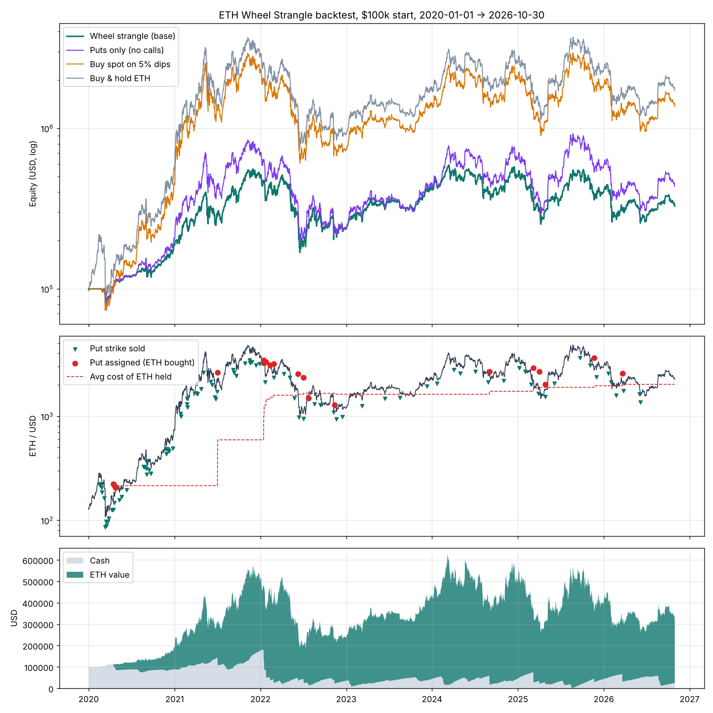

# ETH "Wheel Strangle" options backtest (2020 → Oct 2026)

A backtest of a dip-triggered ETH put-selling and covered-call ladder, based on the
*Wheel Strangle* deck (Phase 1: sell puts to get in; Phase 2: covered strangle and ladder).

```bash
pip install -r requirements.txt
python run_backtest.py          # about 15s, writes everything to results/
```

> **Looking for lower drawdowns?** See [IMPROVEMENTS.md](IMPROVEMENTS.md). It tests 8 variants on ETH, BTC, SPY, QQQ and GLD.
> A diversified put-spread ladder with a trend filter returned about 7.5 % CAGR with a -5.5 % max drawdown.
>
> **When does it beat buy & hold?** See [REGIMES.md](REGIMES.md). In short: in every ETH bear phase, almost never in bull phases.
>
> **Combined portfolio:** see [COMBO.md](COMBO.md). Put-spread ladder + trend sleeve across ETH, BTC, SPY and GLD returned about 12.8 %/yr with a -6.8 % max drawdown, positive in every year except 2022 (-5.4 %).
> A step-by-step walkthrough of the ETH-only version, with real trades, is in [HOW_ETH_P4_WORKS.md](HOW_ETH_P4_WORKS.md).
>
> **Support-level strikes:** see [SUPPORT_LEVELS.md](SUPPORT_LEVELS.md). Selling puts only at solid daily support below the 50 % level of the ATH ↔ last-cycle-low range cut the ETH-only 70/30 drawdown from -11.1 % to -8.3 % (16.1 %/yr).

## Strategy rules as implemented

| Step | Rule (default) | Where it comes from |
|---|---|---|
| Entry signal | ETH closes down **≥ 5 %** on the day (close-to-close, UTC daily bars) | the brief |
| Put | Sell a **60-DTE, 25-delta** cash-secured put (about 16 % OTM on average) | the brief (60d); the deck (16–25Δ) |
| Put sizing | Strike notional = **10 % of current equity**. A put is opened only if free cash (cash minus open-put collateral) covers it, so there is no leverage | the deck: "keep cash reserve", "half-position entry" |
| Put expiry | ETH ≥ strike → keep the premium. ETH < strike → **buy that ETH quantity at the strike** and hold it | the brief |
| Ladder | Every new ≥5 % dip sells another put. On the day of an assignment, another put is sold too | the brief and deck: "sell another put… continue laddering" |
| Covered call | All ETH held that is not already covered gets a **14-DTE, 20-delta** call (about 13 % OTM on average), re-sold at every expiry | the brief (14d, 20–25Δ) |
| Call ITM | Default `cash_settle` (Deribit style): **keep the ETH** and pay the intrinsic value. ETH is sold only if cash drops below put collateral. The variant `called_away` is the classic wheel, where ETH is sold at the strike | the brief: "long-term gains" |

**Pricing:** Black-Scholes on daily closes with r = 0. The volatility input is **Deribit ETH DVOL**.
Puts get +2 vol points of skew. Every trade crosses 1 vol point of half-spread. The Deribit option fee
is 0.03 % of the underlying, capped at 12.5 % of the premium. Spot buys and sells pay 0.1 %. Idle cash earns no interest.

**Data (in `data/`):**
* `ETHUSDT_1d_binance.csv`: Binance ETH/USDT daily OHLCV from 2019-09-01 to 2026-10-30. It was cross-checked against a second independent copy: 0 differences and 0 missing days.
* `ETH_DVOL_1d_deribit.csv`: Deribit ETH DVOL daily from 2021-03-24 to 2026-10-30. It was cross-checked against two other copies.
* **DVOL starts on 2021-03-24.** For 2020 to March 2021, IV is a proxy fitted on the overlap period:
  `ln(DVOL) = 1.54 + 0.54·ln(RV30) + 0.12·ln(RV7)` (R² = 0.67). This gives about 80 % median IV in 2020 and about 180 % in the March-2020 crash. Results from that window are therefore less reliable. The table further down repeats the test from 2021-03-24.

## Headline results ($100k start, 2020-01-01 → 2026-10-30)

| Strategy | Final equity | CAGR | Max DD | Sharpe |
|---|---|---|---|---|
| **Wheel strangle (base)** | **$327,556** | **19.0 %** | **-69.8 %** | 0.59 |
| Puts only (no covered calls) | $436,037 | 24.0 % | -77.1 % | 0.66 |
| Classic wheel (ETH called away) | $194,682 | 10.2 % | -48.6 % | 0.49 |
| Buy spot on every 5 % dip (same sizing) | $1,367,197 | 46.6 % | -79.3 % | 0.88 |
| Buy & hold ETH from 2020-01-01 | $1,715,450 | 51.6 % | -79.3 % | 0.93 |



### What the base case actually did
* **89 puts sold**, of which **19 were assigned** (21 %). 85 % of puts were profitable, and the put leg made **+$63k** net (premium $136k minus assignment losses).
  **108 dip signals were skipped** because all cash was already committed as collateral or spent on ETH.
* **1,259 covered calls** were sold for **$724k** of premium. 18 % finished ITM, and those cost **$906k** to settle,
  so the call leg made **-$185k**. That is the single biggest drag.
* It bought 303 ETH at an average of $1,557. It sold 168 ETH, mostly to fund ITM call settlements, and ends with 135 ETH plus $25k cash.

### Calendar years

| Year | Wheel | Puts only | Buy the dip | Buy & hold |
|---|---|---|---|---|
| 2020 | 87 % | 106 % | 348 % | 463 % |
| 2021 | 165 % | 233 % | 399 % | 399 % |
| 2022 | **-52 %** | -66 % | -68 % | -68 % |
| 2023 | 78 % | 88 % | 91 % | 91 % |
| 2024 | 18 % | 45 % | 46 % | 46 % |
| 2025 | -20 % | -11 % | -11 % | -11 % |
| 2026 YTD | -18 % | -24 % | -24 % | -24 % |

### Robustness: different start dates (CAGR / max DD)

| Start | Wheel | Puts only | Buy the dip | Buy & hold |
|---|---|---|---|---|
| 2020-01-01 | 19.0 % / -70 % | 24.0 % / -77 % | 46.6 % / -79 % | 51.6 % / -79 % |
| 2021-03-24 (real DVOL only) | 2.7 % / -69 % | 1.1 % / -74 % | -2.4 % / -79 % | 6.4 % / -79 % |
| 2022-01-01 | 1.3 % / -58 % | 5.1 % / -67 % | -4.8 % / -71 % | -10.1 % / -74 % |
| 2023-01-01 | -2.7 % / -54 % | -0.0 % / -68 % | 3.4 % / -68 % | 17.8 % / -68 % |
| 2024-01-01 | -4.5 % / -54 % | -0.9 % / -68 % | -9.5 % / -68 % | -1.6 % / -68 % |

## Takeaways

1. **The 5 %-dip put entry works as an entry tool.** Puts won 85 % of the time and acquired ETH below
   the market price when they were assigned. But the strategy is often **under-invested in bull runs**.
   The March-2020 crash puts (strikes $86–$104) all expired worthless during the V-shaped rebound, so the
   strategy was only about 30 % in ETH during 2020's 5× rally. That one year explains most of the gap to buy & hold.
2. **Covered calls on ETH were a net loss here.** ETH's upside moves are large enough that 14-day 13 %-OTM calls
   finish ITM 18 % of the time and give back more than all the premium collected. More calls made it worse (shorter DTE and higher delta
   collect more but pay out even more). Removing calls ("puts only") raised CAGR from 19 % to 24 %, at the cost of
   a deeper drawdown (-77 % vs -70 %). The calls do cushion the downside (2022: -52 % vs -66 %), but ETH has been trending, not range-bound.
3. **Classic called-away mode** has the lowest drawdown (-49 %) because it keeps exiting ETH. It is the weakest on return (10 % CAGR)
   and leaves you with no long-term ETH stack, which goes against the goal in the brief.
4. **Sensitivity:** more aggressive puts (higher delta, smaller trigger) earned more, because more capital ended up in ETH.
   At a 10 % trigger the strategy is mostly cash. That lowers drawdown (-43 to -48 %) but CAGR falls to 2–7 %. See `results/RESULTS.md`.
5. **Starting after the 2020 rally, results are mixed.** The wheel's max drawdown is 10–16 points smaller than buy & hold in every start year.
   It beats buy & hold when started into the 2022 bear market (+1.3 % vs -10.1 % CAGR) and lags badly when started before the 2023 recovery (-2.7 % vs +17.8 %).
   The deck's "always a plan" holds. "Better than holding" did not.

## Files

* `wheel_backtest.py`: engine (pricing, strategy loop, benchmarks, metrics). All rules are in `Config`.
* `run_backtest.py`: runs the base case, variants, start-date robustness and sensitivity grids, and writes `results/`.
* `results/RESULTS.md`: all tables. `trades_base.csv` is every trade. `equity_base.csv` is the daily book. `*.png` are charts.

## Limitations

* Options are priced from an IV index (DVOL is roughly 30-day ATM), not from historical Deribit quotes. Real 25Δ put skew, the 60d/14d term
  structure and bid/ask can differ, especially in crashes. The pre-2021-03 IV is a model proxy.
* Daily-close granularity: trades fill at the UTC close, and intraday moves and early exercise are ignored. Strikes are not rounded to listed strikes.
* No rolling of threatened puts and no interest on idle cash. Earning about 4–5 % on USDC would add materially to every option strategy here.
