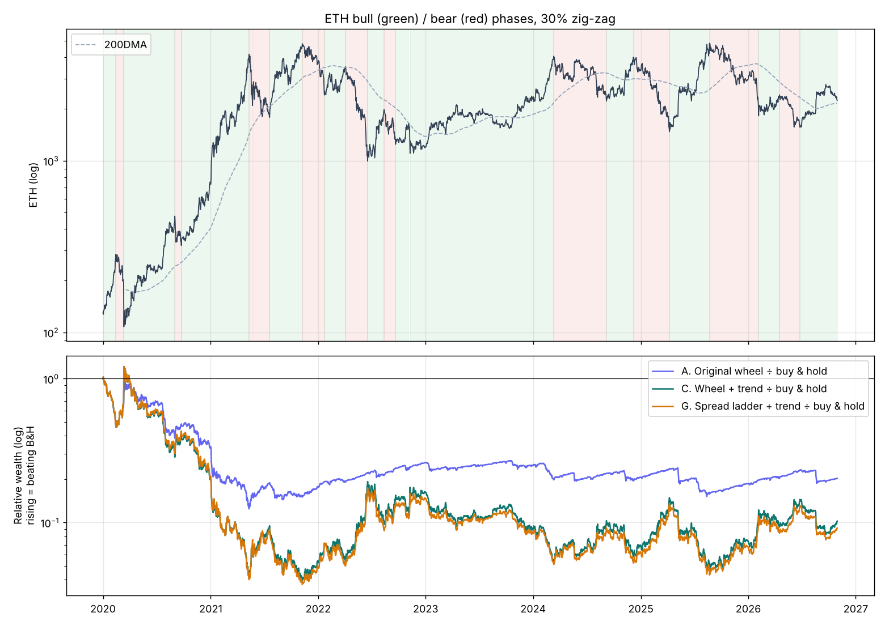
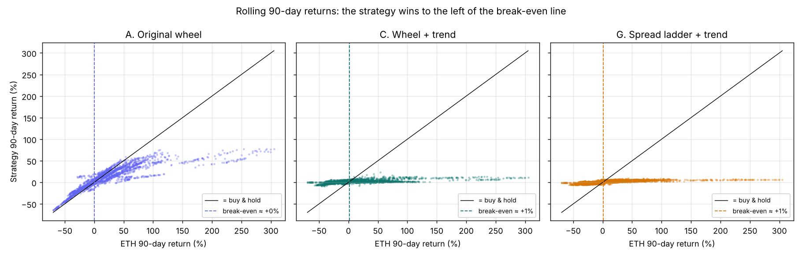

# When did the strategy beat buy & hold ETH, and in which market conditions?

```bash
python regime_analysis.py     # about 15s, writes results/regimes/
```

Strategies compared with buy & hold ETH (2020-01-01 → 2026-10-30, ETH only):

* **A.** The original wheel: 5 %-dip → 60d 25Δ put, hold assigned ETH, 14d 20Δ covered calls.
* **C.** Classic wheel + 200DMA trend filter and exit.
* **G.** Weekly 25Δ/10Δ put-spread ladder, only above the 200DMA.

C and G are low-drawdown versions from [IMPROVEMENTS.md](IMPROVEMENTS.md).

## Short answer

**The strategy beat buy & hold whenever ETH went down or sideways. It lost whenever ETH went up meaningfully.**
Nothing else (implied vol level, trend state at the start of the month) mattered much. The deciding factor is the
direction and size of ETH's *next* move, which you can't know in advance.

| Condition | A beat B&H | C beat B&H | G beat B&H |
|---|---|---|---|
| **Bear phases** (≥30 % ETH declines, 11 of them) | **11 / 11** | 11 / 11 | 11 / 11 |
| **Bull phases** (≥30 % ETH rallies, 12 of them) | **1 / 12** | 0 / 12 | 0 / 12 |
| Months ETH fell > 5 % (29) | 100 % | 100 % | 100 % |
| Months ETH flat, ±5 % (15) | 93 % | 67 % | 73 % |
| Months ETH rose 5–20 % (19) | 37 % | 0 % | 0 % |
| Months ETH rose > 20 % (19) | 0 % | 0 % | 0 % |
| **Started on a date after which ETH ended lower** (9 start dates) | **9 / 9** | 9 / 9 | 9 / 9 |
| Started on a date after which ETH ended higher (15 start dates) | 1 / 15 | 3 / 15 | 2 / 15 |

**The break-even point:** over any 90-day window, strategy A beat buy & hold when ETH's return was below about **0 %**.
C and G broke even at about +1 %.


*Bottom panel: strategy wealth ÷ buy & hold wealth. Where it rises, the strategy is winning. Every rise lines up with a red (bear) phase.*

## 1. Bull and bear phases (30 % zig-zag)

| Phase | Type | ETH | ETH move | A | C | G |
|---|---|---|---|---|---|---|
| 2020-02-14 → 03-12 | Bear (COVID crash) | 285 → 108 | -62 % | **-20 %** | **0 %** | **0 %** |
| 2020-03-12 → 09-01 | Bull | 108 → 475 | +341 % | +76 % | +3 % | +9 % |
| 2020-09-23 → 2021-05-11 | Bull (DeFi/2021 run) | 321 → 4,173 | **+1,201 %** | +234 % | +33 % | +20 % |
| 2021-05-11 → 05-23 | Bear (May-21 crash) | 4,173 → 2,096 | -50 % | **-36 %** | **-15 %** | **-4 %** |
| 2021-07-20 → 11-08 | Bull | 1,786 → 4,808 | +169 % | +114 % | +13 % | +11 % |
| 2021-11-08 → 2022-01-22 | Bear | 4,808 → 2,412 | -50 % | **-36 %** | **-10 %** | **-2 %** |
| 2022-01-22 → 04-03 | Bull (bear-mkt rally) | 2,412 → 3,522 | +46 % | +45 % | +11 % | +1 % |
| 2022-04-03 → 06-18 | Bear (LUNA / 3AC) | 3,522 → 995 | -72 % | **-67 %** | **0 %** | **-1 %** |
| 2022-06-18 → 08-13 | Bull (bear-mkt rally) | 995 → 1,984 | +99 % | +90 % | 0 % | 0 % |
| 2022-11-09 → 2024-03-11 | Bull (slow grind) | 1,103 → 4,065 | +269 % | +199 % | +10 % | +18 % |
| 2024-03-11 → 09-06 | Bear | 4,065 → 2,225 | -45 % | **-39 %** | **+7 %** | **-1 %** |
| 2024-12-08 → 2025-04-08 | Bear | 4,004 → 1,473 | -63 % | **-56 %** | **-5 %** | **-5 %** |
| 2025-04-08 → 08-22 | Bull | 1,473 → 4,832 | +228 % | +119 % | +3 % | +5 % |
| 2025-08-22 → 2026-02-05 | Bear | 4,832 → 1,827 | -62 % | **-53 %** | **-1 %** | **-3 %** |
| 2026-02-05 → 04-17 | Bull | 1,827 → 2,419 | +32 % | **+36 %** | +1 % | +1 % |

*(All 23 phases are in `results/regimes/phases.csv`. Bold = beat buy & hold.)*

**Reading it:**
* **Strategy A softens crashes but doesn't avoid them.** In bear phases its median loss was -36 %, against ETH's -50 %.
  Premium income cushions the fall, but it still holds the ETH it was assigned on the way down.
* **In fast, sustained bull runs A falls far behind.** In 2020–21 it captured only 19–22 % of ETH's gain, and 52 % in 2025.
  Most of its capital was still in cash waiting for dips, and the covered calls capped what it did own.
* **A kept up only in short rallies inside a bear market,** in 2022 and early 2026. It captured 89–110 % of the gain there.
  It was already full of cheaply assigned ETH, and implied vol (and so the premium) was high after the crash.
  Its one bull-phase win (Feb–Apr 2026, +32 %) was this type of slow rally.
* **C and G are essentially out of ETH** (beta about 0.03). They "win" every bear phase by sitting in cash and T-bills, and they miss every rally.

## 2. Monthly conditions

| Condition at the start of the month | Months | A beat B&H | C beat | G beat |
|---|---|---|---|---|
| ETH above 200DMA | 47 | 60 % | 47 % | 49 % |
| ETH below 200DMA | 35 | 63 % | 49 % | 49 % |
| Implied vol < 60 | 20 | 65 % | 45 % | 45 % |
| Implied vol 60–80 | 35 | 69 % | 54 % | 57 % |
| Implied vol > 80 | 27 | 48 % | 41 % | 41 % |
| Options rich (IV > realised vol over the month) | 50 | 66 % | 46 % | 48 % |
| Options cheap (IV < realised vol over the month) | 32 | 53 % | 50 % | 50 % |

None of the conditions *known in advance* sorted winning months from losing ones well (all are roughly 50–70 %).
High-IV months were slightly *worse* for A. High IV in ETH tends to come with big moves in both directions, and the big up-moves hurt.
The "options rich" split is somewhat favourable (66 % vs 53 %), but you only know it after the month ends.

## 3. Up/down capture: why A lost overall

| Strategy | Up-capture | Down-capture | Beta | Months beating B&H |
|---|---|---|---|---|
| A. Original wheel | **55 %** | **68 %** | 0.52 | 61 % |
| C. Wheel + trend | 5 % | 0 % | 0.03 | 48 % |
| G. Spread ladder + trend | 6 % | 3 % | 0.04 | 49 % |

Strategy A **beat buy & hold in 61 % of months**, yet ended far behind. It kept 68 % of ETH's down-months but only 55 % of its up-months.
That is the wrong way round for a long-term holder. The covered calls give away the big up-months, while the assigned ETH takes most of the down-months.
ETH's return comes in a few huge rallies, so losing those outweighs many small monthly wins.



## 4. Does it depend on when you start?

Each strategy was re-run *fresh* from every turning point to 2026-10-30 (CAGR):

| Start | ETH at start | ETH CAGR to end | A | C | G | Winner |
|---|---|---|---|---|---|---|
| 2020-03-12 (COVID low) | 108 | +58.0 % | 8.6 % | 8.8 % | 7.0 % | B&H |
| 2021-05-11 (top) | 4,173 | -10.7 % | 2.8 % | 6.1 % | 3.7 % | all three |
| 2021-11-08 (ATH) | 4,808 | -14.2 % | -4.3 % | 3.7 % | 2.7 % | all three |
| 2022-06-18 (LUNA low) | 995 | +20.5 % | 5.0 % | 4.2 % | 4.0 % | B&H |
| 2022-11-09 (FTX low) | 1,103 | +19.6 % | 1.2 % | 4.4 % | 4.1 % | B&H |
| 2024-03-11 (top) | 4,065 | -20.1 % | -3.3 % | 2.7 % | -0.4 % | all three |
| 2024-09-06 | 2,225 | +0.4 % | **-6.5 %** | 0.1 % | 0.2 % | B&H (barely) |
| 2025-08-22 (ATH) | 4,832 | -47.5 % | 3.3 % | 1.6 % | -3.2 % | all three |

*(All 24 start dates are in `results/regimes/start_at_turning_points.csv`.)*

* **A beat buy & hold from all 9 start dates where ETH ended lower.** It won from only 1 of 15 where ETH ended higher.
* **The worst case for A is a big round trip** (Sep 2024 start, ETH +0.4 % overall). ETH ran from about $2.2k to $4.8k and fell back.
  The calls capped the rally, while the ETH bought on dips took the full fall: -6.5 %/yr while ETH was flat.

## What this means in practice

1. **This is a strategy for bearish-to-sideways markets, not a better way to own ETH.**
   If you expect ETH to rise strongly over your horizon, buy & hold (or buy-the-dip) wins almost every time.
2. **Its best environment is choppy or declining ETH with elevated but not extreme IV.** 2022 was the clearest example, and so was late 2025 to 2026.
3. **The original version's weak point is huge, fast rallies.** Two fixes help if you want more ETH upside than C or G:
   sell calls further out of the money (10–15Δ), or skip covered calls when ETH is above its 200DMA.
   In the earlier sensitivity tests, dropping the calls entirely raised CAGR from 19 % to 24 %.
4. **You can't reliably pick the regime in advance.** The conditions known at entry (trend, IV level) barely separated winning months from losing ones.
   So size it as a *complement* to a core ETH holding (or to T-bills), not as a timing tool.

## Files

* `regime_analysis.py`: the analysis
* `results/regimes/phases.csv`: every bull/bear phase with strategy returns
* `results/regimes/monthly_regimes.csv` and `monthly_by_*.csv`: monthly returns with features, and the grouped tables
* `results/regimes/rolling90_by_eth_return.csv`, `capture.csv`, `start_at_turning_points.csv`
* `results/regimes/relative_performance.png`, `rolling90_payoff.png`
