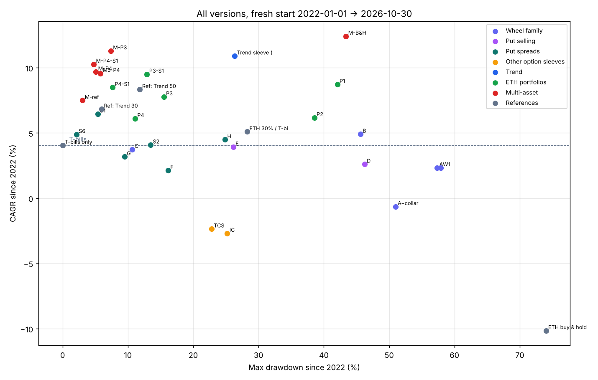
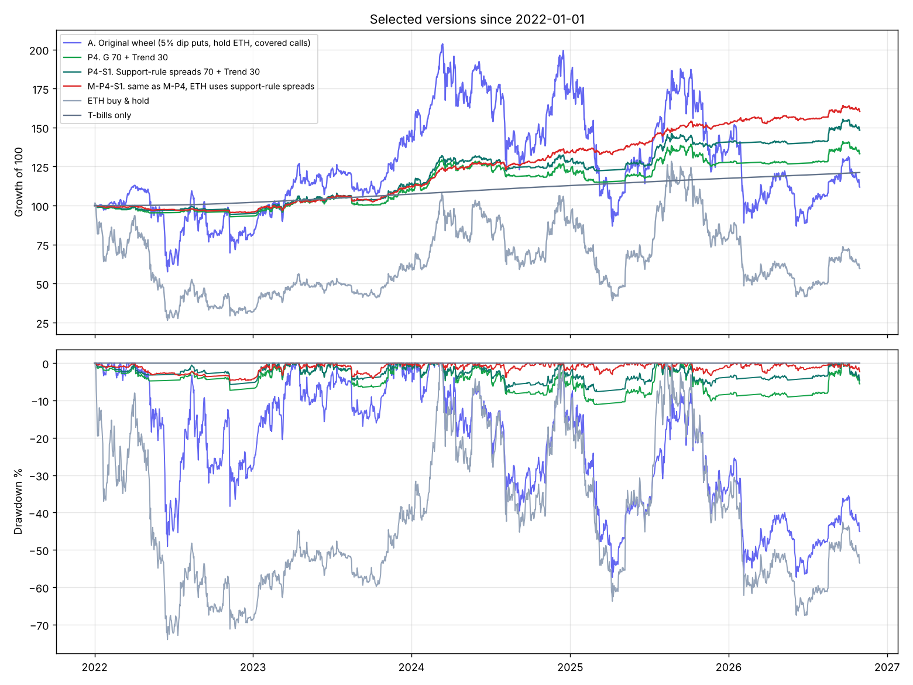

# All strategy versions, fresh start 2022-01-01 → 2026-10-30

```bash
python since2022_study.py      # about 30s, writes results/since2022/
```

Every version is re-run **from scratch on 1 Jan 2022** with $100k. Nothing is carried over from 2020–21.
This is a much harder test than 2020–2026:

* It starts two months after ETH's 2021 top. **ETH buy & hold lost 40 %** (-10.1 %/yr, -74 % max drawdown).
* T-bills paid **4.1 %/yr (+21 % total)**. That is the real hurdle. A strategy that can't beat T-bills isn't worth its risk.
* All crypto options in this window are priced from **real Deribit DVOL** (no pre-2021 volatility proxy).



## Full results

(CAGR, max drawdown, calendar-year returns. 2026 is to 30 Oct. "vs T-bills" = CAGR minus 4.1 %.)

### Wheel family (ETH)

| Version | CAGR | vs T-bills | Max DD | 2022 | 2023 | 2024 | 2025 | 2026 |
|---|---|---|---|---|---|---|---|---|
| A. Original wheel | 2.3 % | -1.7 | -57.3 % | -19.1 | +78.1 | +19.6 | -21.3 | -17.6 |
| A + protective-put collar | -0.6 % | -4.7 | -51.0 % | -23.4 | +61.4 | +4.2 | -19.6 | -6.4 |
| B. Classic wheel (called away) | 4.9 % | +0.9 | -45.6 % | +9.5 | +9.7 | +17.7 | -14.9 | +4.7 |
| C. Classic wheel + 200DMA trend exit | 3.7 % | -0.3 | -10.7 % | +1.3 | +7.2 | +11.2 | -4.6 | +3.6 |
| W1. Wheel with support/below-50 % strikes | 2.3 % | -1.7 | -57.9 % | -10.8 | +63.8 | +16.2 | -19.1 | -18.6 |

### Put selling and put spreads (ETH)

| Version | CAGR | vs T-bills | Max DD | 2022 | 2023 | 2024 | 2025 | 2026 |
|---|---|---|---|---|---|---|---|---|
| D. Put-write ladder, 100 % notional | 2.6 % | -1.5 | -46.2 % | -13.5 | +31.2 | +27.3 | -4.4 | -18.1 |
| E. Put-write ladder, 50 % notional | 3.9 % | -0.1 | -26.1 % | -5.5 | +17.7 | +15.9 | +0.4 | -6.9 |
| F. Put-spread ladder, no filter | 2.1 % | -1.9 | -16.2 % | -4.5 | +15.4 | +11.3 | -4.4 | -5.6 |
| G. Put-spread ladder above 200DMA | 3.2 % | -0.9 | -9.5 % | -0.2 | +11.3 | +6.2 | -3.3 | +2.0 |
| H. Dip-triggered put spreads | 4.5 % | +0.4 | -24.9 % | +3.2 | +9.1 | +14.5 | -8.9 | +5.2 |
| **S1. Support + below-50 % strikes, above 200DMA** | **6.5 %** | **+2.4** | **-5.4 %** | +2.1 | +13.9 | +8.9 | +3.3 | +3.4 |
| S2. Support + below-50 %, no filter | 4.1 % | 0.0 | -13.5 % | -6.0 | +16.0 | +15.0 | +4.1 | -7.1 |
| S6. Control: fixed 28 % OTM, above 200DMA | 4.9 % | +0.8 | **-2.1 %** | +2.1 | +6.6 | +7.6 | +4.2 | +3.2 |
| TCS. Put spreads up / call spreads down | -2.4 % | -6.4 | -22.8 % | +7.0 | -3.3 | +2.2 | -14.3 | -1.7 |
| IC. Iron-condor ladder | -2.7 % | -6.7 | -25.2 % | +1.3 | +5.4 | +3.2 | -15.2 | -6.3 |

### Trend sleeve and ETH-only portfolios

| Version | CAGR | vs T-bills | Max DD | Worst 12 m | 2022 | 2023 | 2024 | 2025 | 2026 |
|---|---|---|---|---|---|---|---|---|---|
| Trend sleeve alone | 10.9 % | +6.8 | -26.4 % | -21.8 % | -20.7 | +33.1 | +17.2 | +23.0 | +8.4 |
| P1. Wheel 50 + Trend 50 | 8.7 % | +4.7 | -42.1 % | -32.9 % | -16.2 | +54.4 | +19.7 | +0.6 | -3.8 |
| P2. Wheel+collar 50 + Trend 50 | 6.2 % | +2.1 | -38.5 % | -33.2 % | -20.0 | +46.9 | +11.4 | +0.5 | +1.6 |
| P3. G 50 + Trend 50 | 7.8 % | +3.7 | -15.5 % | -13.1 % | -10.8 | +22.1 | +13.2 | +10.1 | +5.6 |
| P4. G 70 + Trend 30 | 6.1 % | +2.1 | -11.1 % | -9.7 % | -6.6 | +17.8 | +10.8 | +4.8 | +4.3 |
| **P4-S1. Support spreads 70 + Trend 30** | **8.5 %** | **+4.4** | **-7.6 %** | **-6.0 %** | -5.1 | +19.7 | +12.9 | +9.7 | +5.3 |
| P3-S1. Support spreads 50 + Trend 50 | 9.5 % | +5.5 | -12.9 % | -10.6 % | -9.7 | +23.5 | +14.8 | +13.8 | +6.4 |
| *Ref: Trend 30 + T-bills 70* | *6.8 %* | *+2.8* | *-6.0 %* | *-3.5 %* | -5.1 | +13.3 | +10.2 | +10.4 | +5.2 |
| *Ref: Trend 50 + T-bills 50* | *8.3 %* | *+4.3* | *-11.8 %* | *-8.9 %* | -9.8 | +18.8 | +12.9 | +14.4 | +6.3 |
| *ETH 30 % / T-bills 70 %* | *5.1 %* | *+1.0* | *-28.3 %* | | -20.8 | +27.9 | +22.6 | +5.4 | -2.8 |
| *ETH buy & hold* | *-10.1 %* | *-14.2* | *-74.0 %* | | -68.2 | +90.8 | +46.3 | -11.0 | -24.4 |

### Multi-asset (same recipe on each asset, equal weight)

| Version | CAGR | vs T-bills | Max DD | Worst 12 m | 2022 | 2023 | 2024 | 2025 | 2026 |
|---|---|---|---|---|---|---|---|---|---|
| **M-P4-S1. ETH+BTC+SPY+GLD, 70 / 30, ETH uses support spreads** | **10.3 %** | **+6.2** | **-4.8 %** | **-0.3 %** | -4.1 | +16.8 | +19.6 | +13.6 | +5.3 |
| M-P4. ETH+BTC+SPY+GLD, G 70 / Trend 30 | 9.7 % | +5.6 | -5.1 % | -0.5 % | -4.5 | +16.4 | +19.1 | +12.4 | +5.1 |
| M-P3. ETH+BTC+SPY+GLD, G 50 / Trend 50 | 11.3 % | +7.2 | -7.4 % | -1.0 % | -6.8 | +20.2 | +22.2 | +16.0 | +5.6 |
| M5-P4. All 5 (adds QQQ), 70 / 30 | 9.6 % | +5.5 | -5.8 % | -1.1 % | -5.4 | +17.3 | +18.2 | +11.8 | +6.0 |
| *M-ref. Trend 30 / T-bills 70 on the 4 assets* | *7.5 %* | *+3.4* | *-3.1 %* | *+1.2 %* | -2.5 | +12.3 | +12.5 | +10.2 | +4.4 |
| *4-asset buy & hold* | *12.4 %* | *+8.4* | *-43.4 %* | | -40.3 | +66.0 | +58.8 | +19.2 | -6.1 |



### Does it depend on the start date? (fresh starts every 6 months, CAGR to Oct 2026)

| Start | Original wheel | P4 (G) | **P4-S1** | ETH buy & hold | T-bills |
|---|---|---|---|---|---|
| 2022-01 | 2.3 % | 6.1 % | **8.5 %** | -10.1 % | 4.1 % |
| 2022-07 | 4.4 % | 8.0 % | **10.3 %** | 18.9 % | 4.4 % |
| 2023-01 | 0.2 % | 9.7 % | **12.3 %** | 17.8 % | 4.6 % |
| 2023-07 | -1.0 % | 7.1 % | **10.4 %** | 4.7 % | 4.5 % |
| 2024-01 | -2.4 % | 6.5 % | **9.5 %** | -1.6 % | 4.4 % |
| 2024-07 | -6.1 % | 2.2 % | **5.7 %** | -16.7 % | 4.2 % |
| 2025-01 | -2.1 % | 4.9 % | **8.6 %** | -19.8 % | 4.0 % |
| 2025-07 | 4.3 % | 9.1 % | **12.9 %** | -5.0 % | 3.9 % |

P4-S1's max drawdown was -6.2 % to -7.6 % from every start. The original wheel's was -19 % to -57 %.

## What the 2022+ test tells us

1. **Most single option strategies on ETH did *not* beat T-bills.**
   That includes the original wheel (2.3 %), the collar (-0.6 %), put-writing (2.6–3.9 %), and plain put spreads (2.1–3.2 %).
   Call spreads and iron condors lost money. Selling ETH options at "normal" strikes was not a good trade from 2022.
2. **The original wheel beat ETH by a wide margin but lost to cash.** It made +11.8 % in total vs ETH's -40 %, but T-bills made +21 %, and it had a -57 % drawdown along the way.
3. **Your support / below-50 % rule is the one put-selling change that clearly works here.** S1 made 6.5 %/yr with a -5.4 % max DD.
   It was positive every year, including 2022 and 2025, and beat T-bills by 2.4 %/yr.
   Note that the control with the same distance and no levels (S6) had an even smaller drawdown (-2.1 %) but earned less (4.9 %). The *distance* does the protecting, and the *levels* add the return.
4. **The trend sleeve does the heavy lifting on return** (10.9 %/yr), but alone it falls 20–26 %.
   Pairing it with low-risk put spreads gives the best balance.
5. **Best ETH-only version: P4-S1** (70 % support-rule put spreads + 30 % trend). It made **8.5 %/yr with a -7.6 % max DD, worst year -5.1 % (2022)**.
   It beat T-bills from every 6-month start date (5.7–12.9 %/yr).
   Honest comparison: plain *Trend 30 + T-bills 70* made 6.8 %/yr with -6.0 %. So the options add about +1.7 %/yr for about 1.6 points more drawdown.
6. **Best overall: the multi-asset version, M-P4-S1** (ETH+BTC+SPY+GLD, with ETH using the support rule). It made **10.3 %/yr with a -4.8 % max drawdown and a worst 12 months of -0.3 %**.
   The only down year was 2022 (-4.1 %), and the Sharpe ratio was 1.75. The 4-asset buy & hold made more (12.4 %) but with a -43 % drawdown.

## Bottom line for "reliable, consistent, low drawdown"

| Goal | Version | Since 2022 |
|---|---|---|
| Lowest drawdown, still beats cash | S6/S1 put-spread sleeve alone | 4.9–6.5 %/yr, -2 % to -5 % DD |
| ETH only | **P4-S1** | **8.5 %/yr, -7.6 % DD** |
| Best risk/return | **M-P4-S1 (ETH+BTC+SPY+GLD)** | **10.3 %/yr, -4.8 % DD, worst 12 m -0.3 %** |

**Avoid:** the original wheel (with or without the collar), iron condors, bear call spreads, and naked put-writing on ETH.
Since 2022 none of them beat T-bills on a risk-adjusted basis.

*Caveats as before:* modelled option prices (DVOL/VIX/GVZ with an assumed skew), daily-close fills, and one historical path.
The support-rule parameters were set before this test and were not re-tuned for 2022+.
