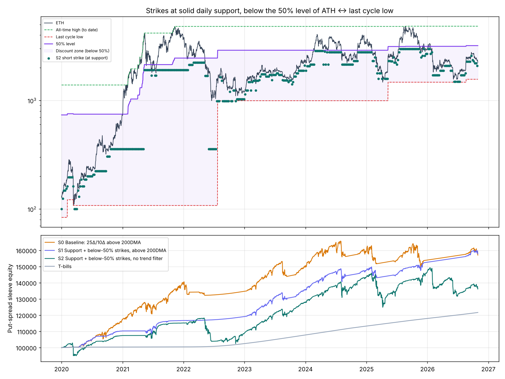

# Strikes only at solid daily support, below the 50% level of ATH ↔ last cycle low

```bash
python support_study.py      # about 1 min, writes results/support/
```

## The rule, made precise (no hindsight: only data known on the trade date)

* **All-time high:** the highest daily close so far. The 2018 high of $1,388 is included via `data/ETHUSDT_1d_binance_full.csv`.
* **Last cycle low:** the bottom of the most recent completed bear market. That is the lowest close after a confirmed fall of at least 60 % from a peak, counted once price has bounced 60 % off it.
  If price later trades below it, the new low is used. ETH's cycle lows found this way:
  $84 (Dec 2018), $108 (Mar 2020), $995 (Jun 2022), $1,473 (Apr 2025), $1,568 (Jun 2026).
* **50 % level** = (ATH + cycle low) / 2. For example, it was $2,902 from mid-2022 to 2025, and $3,153 after the Aug-2025 ATH.
* **Solid daily support:** a zone of at least 2 daily swing lows within 3 % of each other over the last 2 years.
  A swing low is the lowest low within ±5 days, and it only counts once those 5 days have passed.
* **Strike:** the short put goes 1 % under the *highest* solid support that is below price **and** at or below the 50 % level, and no closer than 30 delta.
  The long put goes 15 % below that. If nothing qualifies, skip the week.

Everything else is the same as the put-spread sleeve: weekly, 35-DTE, max loss 2 % of the sleeve, cash-settled, collateral in T-bills.

Example, 5 Mar 2024: ETH was $3,554 and the 50 % level was $2,902 (range $995 → $4,808).
The highest support below price was the $2,883–2,950 zone (3 touches, 2022).
The short put went at **$2,854** (20 % below price) and the long put at $2,426.
The old 25Δ rule would have sold about $3,130, which is above the 50 % level, so this rule would not allow it.



## Results (ETH, 2020-01-01 → 2026-10-30)

### Put-spread sleeve on its own

| Variant | CAGR | Max DD | Worst year | Positive months | Win rate | Strike below price |
|---|---|---|---|---|---|---|
| S0 Baseline: 25Δ / 10Δ, above 200DMA | 6.8 % | -9.5 % | -3.4 % | 84 % | 82 % | 12 % |
| **S1 Your rule + above 200DMA** | **6.9 %** | **-5.4 %** | **+2.1 %** | **95 %** | **94 %** | 28 % |
| S2 Your rule, *no* 200DMA filter | 4.6 % | -14.4 % | -7.1 % | 83 % | 87 % | 24 % |
| S3 Below-50 % only (25Δ strikes), no 200DMA | 6.9 % | -12.8 % | -5.0 % | 84 % | 82 % | 12 % |
| S4 Support only (any level), above 200DMA | 5.8 % | -7.0 % | -2.7 % | 88 % | 88 % | 23 % |
| S6 *Control:* fixed 27 % below price, above 200DMA | 5.9 % | -4.1 % | -0.5 % | 94 % | 96 % | 27 % |

S1 by year: **+10.3 %, +5.8 %, +2.1 %, +13.9 %, +8.9 %, +3.3 %, +3.4 %**. That is positive every year, including 2022 and 2025, the two years that hurt the baseline.

### ETH-only portfolio: 70 % put spreads + 30 % trend sleeve

| Put sleeve used | CAGR | Max DD | Worst year | 2020–23 | 2024–26 CAGR / DD |
|---|---|---|---|---|---|
| S0 Baseline (previous version) | 15.9 % | -11.1 % | -8.5 % | 22.7 % | 6.7 % / -11.1 % |
| **S1 Your rule + 200DMA** | **16.1 %** | **-8.3 %** | **-4.9 %** | 20.7 % | **9.6 % / -7.6 %** |
| S2 Your rule, no 200DMA | 14.3 % | -16.4 % | -9.9 % | 19.5 % | 7.2 % / -14.1 % |

The 70/30 portfolio with S1, by year:

| 2020 | 2021 | 2022 | 2023 | 2024 | 2025 | 2026 YTD |
|---|---|---|---|---|---|---|
| +42.4 % | +31.1 % | **-4.9 %** | +19.7 % | +12.9 % | +9.7 % | +5.3 % |

### Applied to the original wheel (naked dip puts, hold the ETH)

| Variant | CAGR | Max DD |
|---|---|---|
| W0 Original wheel | 20.0 % | -69.9 % |
| W1 Wheel with your strike rule | 20.2 % | -64.9 % |
| W2 W1 without covered calls (just accumulate ETH) | 24.9 % | -75.7 % |
| W3 W1 + sell ETH below 200DMA (calls called away) | 6.6 % | -29.3 % |

Better strikes do **not** fix the wheel. Its drawdown comes from *holding* the assigned ETH through bear markets, not from where the put was sold.

## What actually helps, and how much

1. **Your rule improves the put sleeve. It is the best version tested so far.** The drawdown fell from -9.5 % to -5.4 % at the same return.
   In the ETH 70/30 portfolio, the drawdown fell from -11.1 % to -8.3 %, the worst year improved from -8.5 % to -4.9 %, and 2024–26 returns rose from 6.7 % to 9.6 %/yr.
2. **Most of the drawdown gain comes from selling further out of the money.** The strikes average 28 % below price instead of 12 %.
   The control (S6: a fixed 27 % below price, no levels) gets a similar drawdown (-4.1 %) but about **1 %/yr less return** (5.9 % vs 6.9 %).
   So the support and 50 % levels mainly improve *where* in that distance the strike lands. They pick spots that held, and they earned about 1 %/yr more.
3. **The 50 % rule mattered in 28 % of trades,** mostly in 2024–25 (47 % and 88 % of trades). There the nearest support was above the 50 % level, and the rule pushed the strike lower.
   That is exactly why 2025 turned from -3.3 % (baseline) to +3.3 %.
4. **Keep the 200DMA filter.** Without it (S2), selling at "support" during the 2022 and 2026 bear markets still hurt (-14 % DD).
   Supports break in bear markets.
5. **It holds up under higher costs.** Deep out-of-the-money options have wide bid/ask relative to their premium. At 4× the assumed bid/ask, the put sleeve still made:
   S1 5.6 %, the control 4.9 %, and the baseline 4.3 %. The drawdown didn't change.
6. **It is not tuned to one setting.** Changing the cycle definition (50/70 %), swing size (±3/±10 days), zone tolerance (2/5 %),
   touches (3+), lookback (1 year) or width (10/25 %) kept the sleeve at **5.0–7.5 %/yr with a -4.1 to -6.1 % max DD**.
   The 70/30 portfolio stayed at 14.7–16.5 %/yr with a -8.1 to -10.5 % max DD. See `results/support/robustness_S1.csv`.

## Caveats

* **Less income per trade.** The credit is about 10 % of the spread width (vs 21 %). Much of the sleeve's return is T-bill interest on collateral: $27k interest vs $33k from options.
* **In parabolic rallies the rule is very conservative.** In 2021 the strike sat about 54 % below price and the sleeve made only +5.8 %. The trend sleeve carries those periods.
* **Model limits:** option prices are modelled from DVOL with a simple skew. Real deep-OTM ETH puts often trade at richer vols, which would help the short leg but also make the long leg cost more.
  Deribit's minimum tick (0.0005 ETH) also matters for very cheap wings. Use limit orders, and skip trades where the net credit is only a few ticks.
* **This is one 2020–2026 history.** The rules were fixed before testing, and the sensitivity table varies them, but future bear markets could break supports faster.

## Updated recommended ETH-only setup

* **70 % sleeve, weekly:** if ETH is above its 200DMA, find the highest solid daily support below price that is also below the 50 % level of (ATH, last cycle low).
  Sell a 35-DTE put 1 % under it and buy a put 15 % lower. Size max loss at 2 % of the sleeve. If nothing qualifies, skip.
* **30 % trend sleeve:** unchanged (50/100/200DMA ensemble, 40 % volatility target, next-day execution).
* **Monthly:** rebalance to 70/30.

Backtest: **16.1 %/yr, -8.3 % max drawdown, worst year -4.9 % (2022), 9.6 %/yr since 2024.**

## Files

* `levels.py`: ATH / cycle-low range, swing lows, support zones and the strike rule
* `support_study.py`: all variants, the control, cost stress and robustness
* `results/support/variants.csv`, `yearly.csv`, `robustness_S1.csv`, `cost_stress.csv`, `support_strikes.png`
* `data/ETHUSDT_1d_binance_full.csv`: Binance ETH/USDT daily from 2017-08-17. It is used only for levels and matches the existing file exactly where they overlap.
